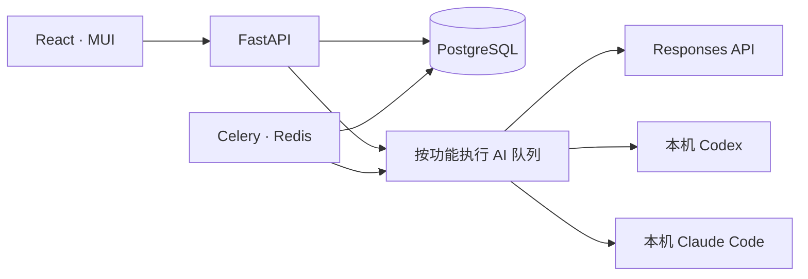

# 设计文档

本页的本地工作台和 AI 路由章节描述当前实现。其余学习模块保留早期详细设计，作为业务语义参考。运行方式见[项目 README](../../../README.md#-快速开始)。

## 当前总体架构



在正常开发入口下，FastAPI 监听 `127.0.0.1`。浏览器导航直接进入工作台，业务路由通过 `get_workspace_user` 获取本地资料。Alembic 创建单行 `workspace_settings`，保存固定资料 ID。唯一旧资料直接关联，其他情况创建新资料，旧记录及外键保留。配置 `WORKSPACE_USER_ID` 可按 UUID 使用另一份已有资料。

开源工作台已移除支付和积分计费的页面、业务服务及 API。旧版相关数据表继续由原迁移维护。能力评估及 PK 页面提供已有记录浏览。

## 组件和接口

### 前端组件架构

#### 核心页面组件
```typescript
// 主要页面组件
interface PageComponents {
  AISettingsPage: React.FC    // 提供方配置与功能路由
  DashboardPage: React.FC     // 用户仪表板
  ChatPage: React.FC          // AI聊天学习界面
  PracticePage: React.FC      // 练习管理页面
  VocabularyPage: React.FC    // 生词表管理
  PKArenaPage: React.FC       // PK对战界面
  ProfilePage: React.FC       // 用户资料和设置
  AdminPage: React.FC         // 管理员控制台
}
```

#### 功能组件
```typescript
// 聊天相关组件
interface ChatComponents {
  ChatInterface: React.FC<{onMessage: (msg: string) => void}>
  FileUploader: React.FC<{onUpload: (file: File) => void}>
  MessageBubble: React.FC<{message: Message, isUser: boolean}>
  TypingIndicator: React.FC
  AsyncTaskIndicator: React.FC<{taskId: string, onComplete: (result: any) => void}>
  TaskProgressBar: React.FC<{progress: number, status: TaskExecutionStatus}>
}

// 练习相关组件
interface PracticeComponents {
  PracticeGroup: React.FC<{group: PracticeGroup}>
  QuestionCard: React.FC<{question: Question, onAnswer: (answer: string) => void}>
  ProgressTracker: React.FC<{current: number, total: number}>
  ResultSummary: React.FC<{results: PracticeResult}>
}

// 词汇管理组件
interface VocabularyComponents {
  VocabularyList: React.FC<{words: VocabularyWord[]}>
  WordCard: React.FC<{word: VocabularyWord}>
  MasteryIndicator: React.FC<{level: MasteryLevel}>
  WordPracticeCreator: React.FC<{selectedWords: string[]}>
}

// 充值相关组件
interface PaymentComponents {
  RechargePanel: React.FC<{packages: RechargePackage[]}>
  PackageCard: React.FC<{package: RechargePackage, onSelect: () => void}>
  PaymentForm: React.FC<{package: RechargePackage, onSubmit: (data: PaymentData) => void}>
  CreditBalance: React.FC<{balance: number}>
  TransactionHistory: React.FC<{transactions: CreditTransaction[]}>
}

// 管理员组件
interface AdminComponents {
  PackageManager: React.FC<{packages: RechargePackage[], onUpdate: (pkg: RechargePackage) => void}>
  PackageEditor: React.FC<{package?: RechargePackage, onSave: (pkg: RechargePackage) => void}>
  UserCreditManager: React.FC<{users: User[]}>
  SystemStats: React.FC<{stats: SystemStatistics}>
  APIKeyTester: React.FC<{onTest: (apiKey: string) => Promise<TestResult>}>
  APIUsageStats: React.FC<{stats: APIUsageStatistics}>
}
```

### 后端API接口

#### 用户管理API
```typescript
interface UserAPI {
  // 认证相关
  GET  /api/users/profile
  
  // 用户配置
  PUT  /api/users/preferences
  GET  /api/users/learning-status
  PUT  /api/users/learning-goals
}
```

#### 学习服务API
```typescript
interface LearningAPI {
  // AI聊天 - 同步
  POST /api/chat/message
  POST /api/chat/upload-material
  GET  /api/chat/history
  
  // AI聊天 - 异步
  POST /api/chat/message-async
  POST /api/chat/upload-material-async
  GET  /api/chat/task-status/:taskId
  GET  /api/chat/task-result/:taskId
  
  // AI功能调用
  POST /api/chat/function-call
  POST /api/chat/function-call-async
  POST /api/chat/parse-intent
  GET  /api/chat/available-functions
  
  // 水平评估
  GET  /api/assessment/current-level
  POST /api/assessment/request-reevaluation
  POST /api/assessment/request-reevaluation-async
  GET  /api/assessment/history
  
  // 每日学习建议
  GET  /api/daily-recommendation
  POST /api/daily-recommendation/generate-async
  POST /api/daily-recommendation/feedback
  POST /api/daily-recommendation/generate-practice-async
}
```

#### 练习系统API
```typescript
interface PracticeAPI {
  // 练习组管理 - 同步
  POST /api/practice/generate-group
  POST /api/practice/generate-comprehensive
  GET  /api/practice/groups
  GET  /api/practice/group/:id
  POST /api/practice/group/:id/submit
  
  // 练习组管理 - 异步
  POST /api/practice/generate-group-async
  POST /api/practice/generate-comprehensive-async
  POST /api/practice/vocabulary-group-async
  GET  /api/practice/generation-status/:taskId
  GET  /api/practice/generation-result/:taskId
  
  // 基于生词表的练习
  POST /api/practice/vocabulary-group
  GET  /api/practice/history
  
  // 能力更新
  POST /api/practice/update-capabilities
}
```

#### 词汇管理API
```typescript
interface VocabularyAPI {
  // 生词表管理
  GET  /api/vocabulary/words
  POST /api/vocabulary/add-words
  DELETE /api/vocabulary/word/:id
  PUT  /api/vocabulary/word/:id/mastery
  
  // 掌握度跟踪
  GET  /api/vocabulary/mastery-stats
  POST /api/vocabulary/update-mastery
}
```

#### PK对战API
```typescript
interface PKApi {
  // 匹配系统
  POST /api/pk/find-match
  GET  /api/pk/match-status
  POST /api/pk/cancel-match
  
  // 对战管理
  GET  /api/pk/battle/:id
  POST /api/pk/battle/:id/answer
  GET  /api/pk/history
  GET  /api/pk/mmr-ranking
}
```

#### 充值支付API
```typescript
interface PaymentAPI {
  // 充值套餐管理
  GET  /api/payment/packages
  GET  /api/payment/package/:id
  
  // 充值流程
  POST /api/payment/create-order
  POST /api/payment/confirm-payment
  GET  /api/payment/order-status/:orderId
  
  // 交易记录
  GET  /api/payment/transactions
  GET  /api/payment/transaction/:id
}
```

#### 任务管理API
```typescript
interface TaskAPI {
  // 任务查询
  GET  /api/tasks/user/:userId
  GET  /api/tasks/status/:taskId
  GET  /api/tasks/result/:taskId
  
  // 任务管理
  POST /api/tasks/cancel/:taskId
  POST /api/tasks/retry/:taskId
  GET  /api/tasks/queue-status
  
  // 批量操作
  POST /api/tasks/batch-status
  POST /api/tasks/batch-cancel
}
```

#### 管理员API
```typescript
interface AdminAPI {
  // 充值套餐管理
  GET    /api/admin/packages
  POST   /api/admin/packages
  PUT    /api/admin/packages/:id
  DELETE /api/admin/packages/:id
  
  // 用户Credit管理
  GET  /api/admin/users/:id/credits
  POST /api/admin/users/:id/credits/adjust
  GET  /api/admin/credit-statistics
  
  // 系统统计
  GET  /api/admin/revenue-stats
  GET  /api/admin/usage-stats
  GET  /api/admin/user-stats
  
  // 任务队列管理
  GET  /api/admin/queue-metrics
  GET  /api/admin/failed-tasks
  POST /api/admin/retry-failed-tasks
  POST /api/admin/clear-queue
  
}
```

### AI 提供方与路由

| API | 用途 |
| --- | --- |
| `GET /api/ai-settings` | 读取配置版本、提供方及队列 |
| `PUT /api/ai-settings` | 按版本号整体保存配置和路由 |
| `POST /api/ai-settings/profiles/{id}/test` | 向指定已保存配置发送短文本测试 |

- 配置记录使用 UUID，包含名称、提供方、模型和超时。Responses API 额外使用完整的 `/responses` 地址、可选 Bearer 密钥和最大输出 Token。保存请求省略密钥时，同端点沿用已有密钥，传入 `null` 时清除密钥，更换端点时须重新录入。密钥字段由后端保存于 PostgreSQL，读接口只返回 `has_api_key`。
- 路由保存为功能键到有序配置 ID 数组的映射。每个队列最多五项，配置 ID 唯一且必须存在。保存时检查版本，冲突返回 HTTP 409。删除配置与移除所有队列引用在同一次更新中提交。
- 功能键覆盖 AI 对话、材料分析、练习生成、结果分析、练习追问、词汇提取、词汇练习、每日推荐、聊天功能识别和意图识别。能力页面展示已存储的资料和评估结果。
- HTTP 与 Celery 请求读取同一份 PostgreSQL 配置。使用功能队列，空队列继承默认队列。网络错误、HTTP 错误、CLI 失败、超时、空响应或结构化结果无效时继续下一项。队列耗尽时提供可读错误，每日推荐可使用规则结果。
- Responses 适配器发送普通文本消息，处理 `output_text` 和分段输出，读取服务方提供的 Token 数据。CLI 适配器使用临时目录和无交互启动参数，禁用模型操作工具，从标准输入传入提示词。

#### AI功能调用系统
```typescript
interface AIFunctionCaller {
  // 意图识别和功能调用
  parseUserIntent(message: string, context: UserContext): Promise<IntentResult>
  
  // 执行系统功能
  executeFunction(intent: FunctionIntent, parameters: any): Promise<FunctionResult>
  
  // 格式化响应
  formatResponse(result: FunctionResult, originalMessage: string): Promise<string>
}

interface IntentResult {
  intent: UserIntent
  confidence: number
  parameters: Record<string, any>
  requiresConfirmation: boolean
  isPrivacySensitive: boolean
}

enum UserIntent {
  // 练习相关
  GENERATE_PRACTICE = "generate_practice",
  VIEW_PRACTICE_HISTORY = "view_practice_history",
  START_PRACTICE = "start_practice",
  
  // 学习进度
  CHECK_PROGRESS = "check_progress",
  VIEW_CAPABILITIES = "view_capabilities",
  SET_LEARNING_GOALS = "set_learning_goals",
  
  // 词汇管理
  ADD_VOCABULARY = "add_vocabulary",
  VIEW_VOCABULARY = "view_vocabulary",
  REMOVE_VOCABULARY = "remove_vocabulary",
  
  // PK对战
  START_PK_MATCH = "start_pk_match",
  VIEW_PK_HISTORY = "view_pk_history",
  CHECK_MMR = "check_mmr",
  
  // 统计查看
  VIEW_STATISTICS = "view_statistics",
  CHECK_CREDITS = "check_credits",
  VIEW_MILESTONES = "view_milestones",
  
  // 设置管理
  UPDATE_PREFERENCES = "update_preferences",
  CHANGE_LANGUAGE = "change_language",
  
  // 学习对话
  LANGUAGE_LEARNING = "language_learning",
  MATERIAL_ANALYSIS = "material_analysis",
  
  // 隐私敏感（拒绝执行）
  ACCOUNT_MANAGEMENT = "account_management",
  PAYMENT_OPERATIONS = "payment_operations",
  PASSWORD_CHANGE = "password_change"
}

interface FunctionIntent {
  intent: UserIntent
  parameters: Record<string, any>
  userId: string
  language: Language
}

interface FunctionResult {
  success: boolean
  data?: any
  error?: string
  requiresUserAction?: boolean
  actionUrl?: string
}
```

### 异步处理系统

#### 任务队列管理
```typescript
interface AsyncTaskManager {
  // 创建异步任务
  createTask(task: AITask): Promise<string>
  
  // 查询任务状态
  getTaskStatus(taskId: string): Promise<TaskStatus>
  
  // 获取任务结果
  getTaskResult(taskId: string): Promise<TaskResult>
  
  // 取消任务
  cancelTask(taskId: string): Promise<boolean>
  
  // 批量处理
  createBatchTasks(tasks: AITask[]): Promise<string[]>
}

interface AITask {
  id: string
  userId: string
  type: AITaskType
  priority: TaskPriority
  
  // 任务参数
  model: string
  prompt: string
  context?: any
  
  // 调度信息
  createdAt: Date
  scheduledAt?: Date
  maxRetries: number
  timeout: number
  
  // 依赖关系
  dependencies?: string[]
  
  // 回调配置
  webhookUrl?: string
  notifyUser: boolean
}

enum AITaskType {
  CHAT_RESPONSE = "chat_response",
  PRACTICE_GENERATION = "practice_generation",
  MATERIAL_ANALYSIS = "material_analysis",
  LEVEL_ASSESSMENT = "level_assessment",
  DAILY_RECOMMENDATION = "daily_recommendation",
  VOCABULARY_EXTRACTION = "vocabulary_extraction",
  FUNCTION_CALL = "function_call"
}

enum TaskPriority {
  LOW = 1,
  NORMAL = 2,
  HIGH = 3,
  URGENT = 4
}

interface TaskStatus {
  taskId: string
  status: TaskExecutionStatus
  progress: number  // 0-100
  
  // 执行信息
  startedAt?: Date
  completedAt?: Date
  estimatedCompletion?: Date
  
  // 错误信息
  error?: TaskError
  retryCount: number
  
  // 资源使用
  tokensUsed?: number
  executionTime?: number
}

enum TaskExecutionStatus {
  QUEUED = "queued",
  PROCESSING = "processing",
  COMPLETED = "completed",
  FAILED = "failed",
  CANCELLED = "cancelled",
  TIMEOUT = "timeout"
}

interface TaskResult {
  taskId: string
  success: boolean
  result?: any
  error?: TaskError
  
  // 执行统计
  executionTime: number
  tokensUsed: number
  retryCount: number
  
  // 缓存信息
  cached: boolean
  cacheKey?: string
  
  completedAt: Date
}

interface TaskError {
  code: string
  message: string
  details?: any
  retryable: boolean
}

#### 队列优化策略
```typescript
interface QueueOptimizer {
  // 负载均衡
  distributeLoad(tasks: AITask[]): Promise<void>
  
  // 批量优化
  optimizeBatch(tasks: AITask[]): Promise<AITask[]>
  
  // 缓存管理
  getCachedResult(cacheKey: string): Promise<TaskResult | null>
  setCachedResult(cacheKey: string, result: TaskResult): Promise<void>
  
  // 性能监控
  getQueueMetrics(): Promise<QueueMetrics>
}

interface QueueMetrics {
  totalTasks: number
  queuedTasks: number
  processingTasks: number
  completedTasks: number
  failedTasks: number
  
  averageWaitTime: number
  averageProcessingTime: number
  throughputPerMinute: number
  
  resourceUtilization: number
  errorRate: number
}

interface AIResponse {
  content: string
  model: string
  tokensUsed: number
  processingTime: number
  metadata?: Record<string, any>
}

interface Message {
  id: string
  userId: string
  content: string
  type: MessageType
  timestamp: Date
  
  // AI响应相关
  aiResponse?: AIResponse
  processingStatus: ProcessingStatus
  
  // 功能调用相关
  detectedIntent?: UserIntent
  functionCalls?: FunctionCall[]
  functionResults?: FunctionResult[]
  
  // 文件上传相关
  attachments?: FileAttachment[]
  
  // 学习数据提取
  extractedVocabulary?: string[]
  identifiedGrammar?: string[]
}

interface FunctionCall {
  id: string
  intent: UserIntent
  parameters: Record<string, any>
  executedAt: Date
  executionTime: number
  success: boolean
}

enum MessageType {
  USER_TEXT = "user_text",
  USER_FILE = "user_file", 
  AI_RESPONSE = "ai_response",
  SYSTEM = "system"
}

enum ProcessingStatus {
  PENDING = "pending",
  PROCESSING = "processing",
  COMPLETED = "completed", 
  FAILED = "failed"
}

interface FileAttachment {
  id: string
  filename: string
  fileType: string
  fileSize: number
  uploadedAt: Date
  processedAt?: Date
  extractedContent?: string
}
```

## 数据模型

### 用户相关模型

#### 用户基础信息
```typescript
interface User {
  id: string
  username: string
  email: string
  role: 'user' | 'admin'
  createdAt: Date
  preferences: UserPreferences
}

interface UserPreferences {
  theme: 'light' | 'dark'
  notifications: NotificationSettings
  practiceReminders: boolean
  dailyQuoteEnabled: boolean
}

interface NotificationSettings {
  email: boolean
  push: boolean
  reviewReminders: boolean
  milestoneUpdates: boolean
  pkInvitations: boolean
}

enum Language {
  ENGLISH = "en",
  JAPANESE = "ja", 
  FRENCH = "fr"
}

enum LanguageLevel {
  A1 = "A1",
  A2 = "A2", 
  B1 = "B1",
  B2 = "B2",
  C1 = "C1",
  C2 = "C2"
}

enum DifficultyLevel {
  BEGINNER = "beginner",
  INTERMEDIATE = "intermediate", 
  ADVANCED = "advanced"
}
```

#### 用户能力信息
```typescript
interface UserCapability {
  userId: string
  language: Language
  
  // 学习配置
  currentLevel: LanguageLevel
  learningGoal: LanguageLevel
  isActiveLearning: boolean
  
  // 综合能力评估
  overallLevel: LanguageLevel
  confidenceScore: number  // 0-100，系统对评估结果的信心度
  
  // 四项技能详细评估
  listeningLevel: number   // 0-100分制
  speakingLevel: number
  readingLevel: number
  writingLevel: number
  
  // 能力细分
  vocabularyCapability: VocabularyCapability
  grammarCapability: GrammarCapability
  comprehensionCapability: ComprehensionCapability
  
  // 评估历史和趋势
  assessmentHistory: CapabilityAssessment[]
  lastAssessedAt: Date
  nextAssessmentDue: Date
  
  // 学习特征
  learningStyle: LearningStyle
  strengths: SkillArea[]
  weaknesses: SkillArea[]
  
  updatedAt: Date
}

interface VocabularyCapability {
  estimatedVocabularySize: number
  masteredWordsCount: number
  learningWordsCount: number
  
  // 词汇水平分布
  basicVocabularyMastery: number    // 基础词汇掌握率
  intermediateVocabularyMastery: number
  advancedVocabularyMastery: number
  
  // 词汇学习效率
  averageLearningSpeed: number      // 单词/天
  retentionRate: number            // 记忆保持率
  
  // 词汇应用能力
  contextualUsageScore: number     // 语境使用能力
  collocationsScore: number        // 搭配使用能力
}

interface GrammarCapability {
  overallGrammarScore: number
  
  // 语法点掌握情况
  grammarPointsMastered: string[]
  grammarPointsLearning: string[]
  grammarPointsWeak: string[]
  
  // 语法应用能力
  sentenceStructureScore: number
  tenseUsageScore: number
  complexityHandlingScore: number
}

interface ComprehensionCapability {
  readingComprehensionScore: number
  listeningComprehensionScore: number
  
  // 理解能力细分
  literalComprehension: number     // 字面理解
  inferentialComprehension: number // 推理理解
  criticalComprehension: number    // 批判性理解
  
  // 处理复杂度
  maxTextComplexity: DifficultyLevel
  processingSpeed: number          // 理解速度
}

interface CapabilityAssessment {
  id: string
  assessmentDate: Date
  assessmentType: AssessmentType
  
  // 评估结果
  overallScore: number
  skillScores: Record<SkillArea, number>
  
  // 评估依据
  dataSource: AssessmentDataSource
  confidenceLevel: number
  
  // 变化分析
  improvementAreas: SkillArea[]
  regressionAreas: SkillArea[]
  
  // 建议
  recommendations: string[]
  nextSteps: string[]
}

enum AssessmentType {
  INITIAL = "initial",
  PERIODIC = "periodic", 
  USER_REQUESTED = "user_requested",
  PERFORMANCE_TRIGGERED = "performance_triggered"
}

enum AssessmentDataSource {
  CHAT_ANALYSIS = "chat_analysis",
  PRACTICE_PERFORMANCE = "practice_performance",
  VOCABULARY_TRACKING = "vocabulary_tracking",
  USER_SELF_REPORT = "user_self_report",
  COMPREHENSIVE_TEST = "comprehensive_test"
}

enum SkillArea {
  VOCABULARY = "vocabulary",
  GRAMMAR = "grammar",
  LISTENING = "listening", 
  SPEAKING = "speaking",
  READING = "reading",
  WRITING = "writing",
  PRONUNCIATION = "pronunciation",
  FLUENCY = "fluency"
}

enum LearningStyle {
  VISUAL = "visual",
  AUDITORY = "auditory",
  KINESTHETIC = "kinesthetic",
  MIXED = "mixed"
}
```

#### 学习进度模型
```typescript
interface LearningProgress {
  userId: string
  language: Language
  
  // 学习统计
  totalStudyTime: number
  streakDays: number
  lastStudyDate: Date
  
  // 里程碑进度
  milestones: Milestone[]
  completedMilestones: string[]
}

interface Milestone {
  id: string
  title: string
  description: string
  targetLevel: number
  tasks: MilestoneTask[]
  estimatedDuration: number
  priority: number
}

interface MilestoneTask {
  id: string
  title: string
  description: string
  type: TaskType
  isCompleted: boolean
  completedAt?: Date
  requiredScore?: number
}

enum TaskType {
  PRACTICE_COMPLETION = "practice_completion",
  VOCABULARY_MASTERY = "vocabulary_mastery",
  LEVEL_ASSESSMENT = "level_assessment",
  STREAK_MAINTENANCE = "streak_maintenance"
}

### 每日学习建议模型

#### 每日学习建议内容
```typescript
interface DailyLearningRecommendation {
  id: string
  userId: string
  language: Language
  date: string  // YYYY-MM-DD格式
  
  // AI生成的学习建议
  recommendations: LearningRecommendation[]
  
  // 生成依据
  basedOnCapability: UserCapability
  basedOnMilestones: Milestone[]
  basedOnVocabulary: VocabularyWord[]
  
  // 快捷练习入口
  quickPracticeOptions: QuickPracticeOption[]
  
  // 用户交互
  userFeedback?: RecommendationFeedback
  isViewed: boolean
  viewedAt?: Date
  
  // AI生成信息
  aiModel: string
  generationTime: number
  tokensUsed: number
  
  createdAt: Date
}

interface LearningRecommendation {
  id: string
  type: RecommendationType
  title: string
  description: string
  priority: number
  
  // 具体建议内容
  focusAreas: SkillArea[]
  suggestedActivities: string[]
  estimatedTime: number
  
  // 关联数据
  relatedVocabulary?: string[]
  relatedGrammar?: string[]
  relatedMilestone?: string
}

interface QuickPracticeOption {
  id: string
  title: string
  description: string
  type: PracticeType
  estimatedQuestions: number
  estimatedTime: number
  
  // 生成参数
  focusAreas: SkillArea[]
  difficultyLevel: DifficultyLevel
  includeVocabulary: string[]
  
  // 快捷生成标识
  canGenerateImmediately: boolean
}

enum RecommendationType {
  VOCABULARY_FOCUS = "vocabulary_focus",
  GRAMMAR_PRACTICE = "grammar_practice",
  SKILL_IMPROVEMENT = "skill_improvement",
  MILESTONE_PROGRESS = "milestone_progress",
  REVIEW_REMINDER = "review_reminder",
  WEAKNESS_TARGETING = "weakness_targeting"
}

interface RecommendationFeedback {
  rating: number  // 1-5星评分
  isHelpful: boolean
  followedRecommendations: string[]  // 用户实际采纳的建议ID
  comments?: string
  submittedAt: Date
}
```

### 练习系统模型

#### 练习组和题目
```typescript
interface PracticeGroup {
  id: string
  userId: string
  title: string
  description: string
  language: Language
  difficulty: DifficultyLevel
  type: PracticeType
  
  // 练习题目
  questions: Question[]
  
  // 元数据
  createdAt: Date
  estimatedDuration: number
  focusAreas: string[]  // 词汇、语法、阅读等
}

interface Question {
  id: string
  type: QuestionType
  content: string
  options: string[]
  correctAnswer: string
  explanation: string
  
  // 关联的知识点
  vocabularyWords: string[]
  grammarPoints: string[]
  difficulty: number
}

enum QuestionType {
  MULTIPLE_CHOICE = "multiple_choice",
  FILL_BLANK = "fill_blank",
  TRANSLATION = "translation",
  VOCABULARY = "vocabulary"
}
```

#### 练习结果模型
```typescript
interface PracticeResult {
  id: string
  userId: string
  practiceGroupId: string
  
  // 答题记录
  answers: QuestionAnswer[]
  
  // 成绩统计
  totalQuestions: number
  correctAnswers: number
  accuracy: number
  totalTime: number
  averageTimePerQuestion: number
  
  // 分析数据
  weakAreas: string[]
  improvedAreas: string[]
  recommendedFocus: string[]
  
  // 能力更新影响
  capabilityUpdates: CapabilityUpdate[]
  vocabularyUpdates: VocabularyUpdate[]
  milestoneProgress: MilestoneProgressUpdate[]
  
  completedAt: Date
}

interface CapabilityUpdate {
  skillArea: SkillArea
  previousScore: number
  newScore: number
  changeReason: string
  confidence: number
}

interface VocabularyUpdate {
  wordId: string
  word: string
  previousMasteryLevel: MasteryLevel
  newMasteryLevel: MasteryLevel
  masteryScoreChange: number
}

interface MilestoneProgressUpdate {
  milestoneId: string
  taskId?: string
  progressChange: number
  isCompleted: boolean
}

interface QuestionAnswer {
  questionId: string
  userAnswer: string
  isCorrect: boolean
  timeSpent: number
  attempts: number
}
```

### 词汇管理模型

#### 生词表模型
```typescript
interface VocabularyWord {
  id: string
  userId: string
  word: string
  language: Language
  
  // 词汇信息
  definition: string
  pronunciation: string
  partOfSpeech: string
  difficulty: number
  frequency: number
  
  // 掌握度跟踪
  masteryLevel: MasteryLevel
  masteryScore: number
  lastReviewedAt: Date
  nextReviewAt: Date
  
  // 学习历史
  addedAt: Date
  firstEncounteredAt: Date
  practiceHistory: VocabularyPracticeRecord[]
  
  // 遗忘曲线参数
  forgettingCurveParams: ForgettingCurveParams
}

enum MasteryLevel {
  NEW = "new",                    // 新词
  LEARNING = "learning",          // 学习中
  SHORT_TERM = "short_term",      // 短期记忆
  LONG_TERM = "long_term",        // 长期记忆
  MASTERED = "mastered"           // 已掌握
}

interface ForgettingCurveParams {
  initialStrength: number
  decayRate: number
  reviewCount: number
  lastReviewScore: number
}
```

#### 已掌握词汇库
```typescript
interface MasteredVocabulary {
  userId: string
  language: Language
  
  // 词汇统计
  totalWords: number
  wordsByLevel: Record<DifficultyLevel, number>
  wordsByCategory: Record<string, number>
  
  // 掌握质量
  averageMasteryScore: number
  retentionRate: number
  
  // 词汇列表
  words: MasteredWord[]
  
  lastUpdated: Date
}

interface MasteredWord {
  word: string
  masteredAt: Date
  masteryScore: number
  category: string
  difficultyLevel: DifficultyLevel
}
```

### PK对战模型

#### MMR系统
```typescript
interface UserMMR {
  userId: string
  language: Language
  
  // MMR评分
  currentMMR: number
  peakMMR: number
  
  // 对战统计
  totalBattles: number
  wins: number
  losses: number
  winRate: number
  
  // 评分历史
  mmrHistory: MMRRecord[]
  
  // 能力评估
  vocabularyRating: number
  grammarRating: number
  speedRating: number
  accuracyRating: number
  
  lastUpdated: Date
}

interface PKBattle {
  id: string
  player1Id: string
  player2Id: string
  language: Language
  
  // 对战配置
  practiceGroupId: string
  startTime: Date
  endTime?: Date
  
  // 对战结果
  player1Score: number
  player2Score: number
  player1Time: number
  player2Time: number
  winnerId?: string
  
  // MMR变化
  player1MMRChange: number
  player2MMRChange: number
  
  status: BattleStatus
}

interface MMRRecord {
  mmr: number
  change: number
  reason: string
  timestamp: Date
}

enum BattleStatus {
  WAITING = "waiting",
  IN_PROGRESS = "in_progress", 
  COMPLETED = "completed",
  CANCELLED = "cancelled",
  TIMEOUT = "timeout"
}

enum PracticeType {
  GENERAL = "general",
  VOCABULARY = "vocabulary",
  GRAMMAR = "grammar", 
  MATERIAL_BASED = "material_based",
  REVIEW = "review"
}

interface VocabularyPracticeRecord {
  practiceId: string
  score: number
  timeSpent: number
  practiceType: PracticeType
  practiceDate: Date
}
```

### Credit系统模型

#### Credit管理
```typescript
interface UserCredit {
  userId: string
  
  // 余额信息
  currentBalance: number
  totalEarned: number
  totalSpent: number
  
  // 交易历史
  transactions: CreditTransaction[]
  
  // 统计信息
  lastPurchaseAt?: Date
  averageMonthlySpending: number
  
  updatedAt: Date
}

interface CreditTransaction {
  id: string
  userId: string
  type: TransactionType
  amount: number
  description: string
  
  // 关联信息
  relatedService?: string
  relatedId?: string
  
  // 元数据
  tokenUsage?: number
  aiModel?: string
  
  createdAt: Date
}

enum TransactionType {
  PURCHASE = "purchase",          // 购买
  CHAT = "chat",                 // 聊天消费
  PRACTICE = "practice",         // 练习消费
  PK_ENTRY = "pk_entry",         // PK参与费
  PK_REWARD = "pk_reward",       // PK奖励
  REFUND = "refund",             // 退款
  ADMIN_ADJUST = "admin_adjust"   // 管理员调整
}

### 充值系统模型

#### 充值套餐模型
```typescript
interface RechargePackage {
  id: string
  name: string
  description: string
  
  // 价格和Credit
  priceInCents: number        // 价格（分）
  currency: string            // 货币类型
  creditAmount: number        // 获得的Credit数量
  bonusCredits: number        // 额外赠送的Credits
  
  // 套餐配置
  isActive: boolean           // 是否启用
  isPopular: boolean          // 是否为热门套餐
  displayOrder: number        // 显示顺序
  
  // 优惠信息
  originalPrice?: number      // 原价（用于显示折扣）
  discountPercentage?: number // 折扣百分比
  
  // 元数据
  createdAt: Date
  updatedAt: Date
  createdBy: string          // 创建者ID（管理员）
}

interface PaymentOrder {
  id: string
  userId: string
  packageId: string
  
  // 订单信息
  amount: number             // 支付金额
  currency: string
  creditAmount: number       // 应获得的Credit数量
  
  // 支付信息
  paymentMethod: PaymentMethod
  paymentGateway: string     // 支付网关
  gatewayOrderId?: string    // 第三方订单ID
  
  // 订单状态
  status: OrderStatus
  paidAt?: Date
  expiredAt: Date
  
  // 元数据
  createdAt: Date
  updatedAt: Date
  
  // 失败信息
  failureReason?: string
  retryCount: number
}

enum PaymentMethod {
  ALIPAY = "alipay",
  WECHAT = "wechat",
  CREDIT_CARD = "credit_card",
  PAYPAL = "paypal"
}

enum OrderStatus {
  PENDING = "pending",        // 待支付
  PAID = "paid",             // 已支付
  PROCESSING = "processing",  // 处理中
  COMPLETED = "completed",    // 已完成
  FAILED = "failed",         // 支付失败
  CANCELLED = "cancelled",    // 已取消
  EXPIRED = "expired"        // 已过期
}
```

### 管理员统计模型

#### 系统统计数据
```typescript
interface SystemStatistics {
  // 收入统计
  revenue: RevenueStats
  
  // 用户统计
  users: UserStats
  
  // 使用统计
  usage: UsageStats
  
  // Credit统计
  credits: CreditStats
  
  generatedAt: Date
}

interface RevenueStats {
  // 总收入
  totalRevenue: number
  
  // 时间段收入
  dailyRevenue: number
  weeklyRevenue: number
  monthlyRevenue: number
  
  // 套餐销售统计
  packageSales: PackageSalesStats[]
  
  // 收入趋势
  revenueTrend: RevenueTrendPoint[]
}

interface PackageSalesStats {
  packageId: string
  packageName: string
  totalSales: number
  totalRevenue: number
  averageOrderValue: number
}

interface UserStats {
  totalUsers: number
  activeUsers: number
  newUsersToday: number
  newUsersThisWeek: number
  newUsersThisMonth: number
  
  // 用户分布
  usersByLanguage: Record<Language, number>
  usersByLevel: Record<LanguageLevel, number>
  
  // 活跃度统计
  dailyActiveUsers: number
  weeklyActiveUsers: number
  monthlyActiveUsers: number
}

interface CreditStats {
  totalCreditsIssued: number
  totalCreditsConsumed: number
  totalCreditsRemaining: number
  
  // 消费分布
  consumptionByFeature: Record<string, number>
  
  // 平均数据
  averageCreditsPerUser: number
  averageMonthlyConsumption: number
}

interface UsageStats {
  // API调用统计
  totalApiCalls: number
  apiCallsByModel: Record<string, number>
  totalTokensUsed: number
  
  // 功能使用统计
  chatSessions: number
  practiceGroupsGenerated: number
  pkBattlesPlayed: number
  vocabularyWordsAdded: number
  
  // 时间分布
  usageByHour: number[]
  usageByDay: number[]
  
  // 平均数据
  averageSessionDuration: number
  averageTokensPerCall: number
}

interface RevenueTrendPoint {
  date: string
  revenue: number
  orders: number
  newUsers: number
}
```
```

## 正确性属性

*属性是一个特征或行为，应该在系统的所有有效执行中保持为真——本质上，是关于系统应该做什么的正式声明。属性作为人类可读规范和机器可验证正确性保证之间的桥梁。*

现在我需要使用prework工具来分析验收标准的可测试性：

基于prework分析，以下是系统的核心正确性属性：

### 属性 1: 用户数据一致性
*对于任何*有效的用户输入数据，系统保存后再查询应该返回相同的数据值
**验证: 需求 1.2, 1.4**

### 属性 2: AI处理管道完整性  
*对于任何*用户输入（文本或文件），系统应该调用适当的AI模型并返回格式化的响应
**验证: 需求 2.2, 2.3, 2.4, 2.5**

### 属性 3: 交互记录完整性
*对于任何*学习会话中的交互，系统都应该完整记录到用户的学习历史中
**验证: 需求 2.6**

### 属性 4: 水平评估数据完整性
*对于任何*水平分析请求，生成的能力报告应该包含听说读写四项技能的评估数据
**验证: 需求 7.1, 7.2**

### 属性 5: 练习组结构一致性
*对于任何*生成的练习组，都应该包含正好十个相关练习题
**验证: 需求 11.1**

### 属性 6: 练习题格式规范性
*对于任何*生成的练习题，都应该以选择题形式呈现，包含问题和多个选项
**验证: 需求 9.2**

### 属性 7: Credit消费规则一致性
*对于任何*功能使用，系统应该按照预设费率准确扣除相应的credits
**验证: 需求 12.1, 12.4**

### 属性 8: PK胜负判定公平性
*对于任何*PK对战结果，胜负判定应该优先基于正确答题数，其次基于用时
**验证: 需求 13.5**

### 属性 9: 词汇自动管理一致性
*对于任何*上传的学习材料，系统应该自动提取词汇并添加到用户生词表
**验证: 需求 14.1**

### 属性 10: 遗忘曲线衰减规律性
*对于任何*生词表中的单词，每日更新都应该按照遗忘曲线降低其掌握程度
**验证: 需求 14.3**

### 属性 11: 掌握单词自动移除
*对于任何*长期表现出掌握的单词，系统应该自动将其从生词表移除
**验证: 需求 14.5**

### 属性 12: 充值支付一致性
*对于任何*成功的支付订单，用户的credit余额应该准确增加对应的数量
**验证: 需求 15.3**

### 属性 13: 套餐配置生效性
*对于任何*管理员对充值套餐的修改，应该立即在用户充值页面生效
**验证: 需求 16.3**

### 属性 14: 每日建议生成一致性
*对于任何*用户每日首次打开学习概览，系统应该基于用户当前能力数据生成个性化学习建议
**验证: 需求 6.1, 6.2**

### 属性 15: 练习能力更新完整性
*对于任何*完成的练习组，系统应该将练习表现数据用于更新用户的所有相关能力信息
**验证: 需求 9.6, 9.7**

### 属性 16: 综合评估数据完整性
*对于任何*综合评估练习请求，系统应该基于用户所有可用信息（里程碑、生词表、能力评估等）生成练习
**验证: 需求 9.2**

### 属性 17: AI功能调用准确性
*对于任何*用户的功能请求，AI应该正确识别意图并调用相应的系统功能
**验证: 需求 2.4, 2.5**

### 属性 18: 隐私操作拒绝性
*对于任何*涉及账户隐私的操作请求，AI应该拒绝执行并建议用户通过相应界面操作
**验证: 需求 17.8**

### 属性 19: 异步任务状态一致性
*对于任何*创建的异步任务，系统应该准确跟踪和报告任务的执行状态
**验证: 异步处理需求**

### 属性 20: 任务结果可靠性
*对于任何*成功完成的异步任务，系统应该能够可靠地返回正确的执行结果
**验证: 异步处理需求**

### 属性 21 · 配置持久性

成功保存后的版本可被下一次 HTTP 或后台调用读取。读取和测试接口只返回允许公开的字段。过期版本的提交失败，保持已提交数据一致。

### 属性 22 · 回退顺序

有功能队列时只遍历该队列。空功能队列使用默认队列。单次请求在首个成功结果处停止，连接测试只调用指定配置。

## 错误处理

### 网络和API错误
- **连接超时处理** - 设置合理的超时时间，提供重试机制
- **API限流处理** - 实现指数退避重试策略
- **AI 提供方错误** - 根据错误类型提供相应的用户提示
- **支付网关错误** - 确保支付状态的一致性，避免重复扣费

### 异步处理错误
- **任务队列溢出** - 实现队列容量限制和优雅降级
- **任务执行超时** - 设置任务超时机制，自动清理超时任务
- **依赖任务失败** - 处理任务依赖链中的失败传播
- **资源竞争** - 实现任务优先级调度和资源分配

### 数据一致性错误
- **并发操作冲突** - 使用乐观锁或悲观锁处理并发更新
- **Credit余额不足** - 在操作前验证余额，操作失败时回滚
- **PK匹配超时** - 设置匹配超时机制，自动取消长时间未匹配的请求

### 用户输入错误
- **文件格式不支持** - 提供清晰的支持格式说明和错误提示
- **内容解析失败** - 降级到基础处理模式，不完全阻断用户操作
- **练习答案验证** - 容错处理用户输入的格式差异

### 系统资源错误
- **存储空间不足** - 实现文件清理策略和用户通知
- **内存溢出** - 限制单次处理的数据量，分批处理大文件
- **数据库连接失败** - 实现连接池和自动重连机制

## 测试策略

### 单元测试方法

**核心业务逻辑测试：**
- 用户认证和授权逻辑
- Credit计算和扣除逻辑  
- MMR评分计算算法
- 遗忘曲线参数计算
- 水平评估算法

**API接口测试：**
- 所有REST API端点的输入输出验证
- 错误状态码和错误消息的正确性
- 认证和权限控制的有效性

**数据模型测试：**
- 数据库模型的约束和关系
- 数据序列化和反序列化
- 数据迁移脚本的正确性

### 属性测试方法

**使用fast-check库进行属性测试，每个测试运行最少100次迭代：**

**用户数据属性测试：**
- 生成随机用户数据，验证保存和查询的一致性
- 测试用户配置更新的幂等性
- 验证用户权限检查的正确性

**AI交互属性测试：**
- 生成随机输入内容，验证AI调用管道的完整性
- 测试不同文件类型的处理一致性
- 验证响应格式化的规范性

**练习系统属性测试：**
- 生成随机用户水平，验证练习难度匹配
- 测试练习组结构的一致性（始终10题）
- 验证答题记录和成绩计算的准确性

**词汇管理属性测试：**
- 生成随机文本内容，验证词汇提取的完整性
- 测试遗忘曲线衰减的数学正确性
- 验证掌握度更新的逻辑一致性

**Credit系统属性测试：**
- 生成随机操作序列，验证余额计算的准确性
- 测试并发操作下的数据一致性
- 验证PK奖励分配的公平性

**PK对战属性测试：**
- 生成随机对战结果，验证胜负判定规则
- 测试MMR计算的数学正确性
- 验证匹配算法的公平性

**充值支付属性测试：**
- 生成随机支付订单，验证credit增加的准确性
- 测试并发支付的数据一致性
- 验证套餐配置变更的即时生效

**管理员功能属性测试：**
- 生成随机套餐配置，验证用户界面的同步更新
- 测试管理员权限控制的正确性
- 验证统计数据计算的准确性

**每日建议属性测试：**
- 生成随机用户能力数据，验证学习建议的个性化程度
- 测试AI调用的一致性和建议质量
- 验证快捷练习生成的准确性

**能力更新属性测试：**
- 生成随机练习结果，验证能力更新的准确性
- 测试多项能力同时更新的一致性
- 验证能力变化对后续推荐的影响

**综合评估属性测试：**
- 生成随机用户数据组合，验证综合评估练习的全面性
- 测试不同数据源权重的合理性
- 验证练习难度与用户能力的匹配度

**AI功能调用属性测试：**
- 生成随机功能请求，验证意图识别的准确性
- 测试功能调用执行的正确性和完整性
- 验证响应格式化的一致性和可读性

**隐私保护属性测试：**
- 生成各种隐私敏感请求，验证AI的拒绝机制
- 测试边界情况下的隐私判断准确性
- 验证拒绝响应的友好性和指导性

**异步处理属性测试：**
- 生成随机异步任务，验证状态跟踪的准确性
- 测试并发任务处理的正确性和性能
- 验证任务失败和重试机制的可靠性

**队列管理属性测试：**
- 生成大量并发请求，验证队列的负载均衡效果
- 测试任务优先级调度的正确性
- 验证缓存机制对性能的提升效果

**AI 路由测试**

- 验证多配置保存、版本冲突、密钥读取与保留、功能覆盖、默认继承及回退顺序。
- 验证无鉴权访问、旧资料迁移及 CLI 不可用时的错误反馈。

### 集成测试策略

**端到端用户流程测试：**
- 启动工作台到学习的流程
- AI聊天到练习生成的完整链路
- PK匹配到对战结束的全流程

**第三方服务集成测试：**
- Responses API 与本机 CLI 的成功、失败和空响应场景
- 支付网关的成功和失败场景
- 邮件服务的发送和失败处理

**性能和负载测试：**
- 并发用户的系统响应能力
- 大量数据处理的性能表现
- 长时间运行的稳定性测试

### 测试数据管理

**测试数据生成策略：**
- 使用工厂模式生成测试用户和数据
- 为不同语言和水平创建测试数据集
- 生成各种边界条件的测试用例

**测试环境隔离：**
- 独立的测试数据库和缓存
- 模拟的第三方服务响应
- 可重复的测试数据初始化

**测试覆盖率要求：**
- 单元测试覆盖率 > 90%
- 属性测试覆盖所有核心业务逻辑
- 集成测试覆盖所有用户关键路径

这个测试策略确保了系统的正确性、可靠性和性能，通过单元测试验证具体功能，通过属性测试验证通用规律，通过集成测试验证整体协作。
