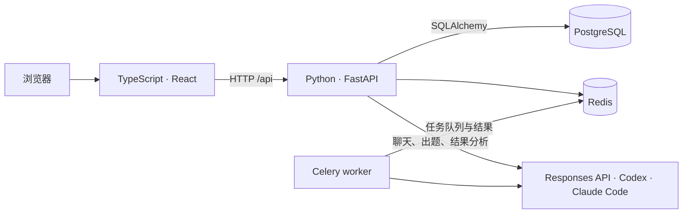

# 🌍 Mnemos- AI Language Learning Application

<div align="center">


一个由 AI 驱动的本地语言学习工作台。

[快速开始](#-快速开始) • [项目结构](#-项目结构) • [开发指南](#-开发指南) • [API 文档](#-api-文档)

</div>

---

## 📖 项目简介

Mnemos 启动后直接打开学习概览，以本地资料保存学习进度。

- 🎯 **个性化学习** - 按主要学习语言提供每日建议与快捷练习
- 💬 **实时交互** - AI 对话、语法纠错和学习反馈
- 📊 **进度追踪** - 练习历史、答题详情和语言能力资料
- ⚙️ **AI 配置** - 自定义 Responses API、本机 Codex 或 Claude Code，支持按功能设置回退队列

---

## 🚀 快速开始

### 前提条件

- Python 3.11 或 3.12
- Node.js 和 npm，用于运行前端开发服务器和构建前端
- Docker 和 Docker Compose，用于启动 PostgreSQL 与 Redis
- Git 和 Make

### 初始化开发环境

在仓库根目录执行下面的命令。使用 Python 3.11 时，把 `python3.12` 改为 `python3.11`。

```bash
python3.12 -m venv python_backend/.venv
python_backend/.venv/bin/python -m pip install -r python_backend/requirements.txt
cp -n python_backend/.env.example python_backend/.env
npm --prefix frontend ci
docker compose up -d --wait
make db-migrate PYTHON_BIN=.venv/bin/python
```

### 启动应用

```bash
# 终端 1，从仓库根目录启动 FastAPI
make dev PYTHON_BIN=.venv/bin/python

# 终端 2，从仓库根目录启动 React
HOST=127.0.0.1 npm --prefix frontend start
```

打开 `http://localhost:3000` 进入工作台。FastAPI 使用本机 8000 端口，PostgreSQL 和 Redis 分别映射到本机 5433 和 6380 端口。

旧数据库升级时运行同一条迁移命令。数据库只有一份旧资料时会自动沿用，存在多份旧资料时会创建一份工作台资料。可在 `python_backend/.env` 设置 `WORKSPACE_USER_ID`，以 UUID 选用某份旧资料。

### 配置 AI

打开侧栏的「AI 配置」，新增配置并保存，再使用「测试连接」验证。

- **Responses API** 填写完整地址（如 `https://api.openai.com/v1/responses`）、模型 ID 和可选 Bearer 密钥。API 密钥保存在本地 PostgreSQL，配置读取接口只返回是否已保存。
- **本机 Codex / Claude Code** 需要对应的 `codex` 或 `claude` 命令出现在 FastAPI/Celery 进程的 PATH，并能通过该 CLI 自身的认证调用模型。模型 ID 可留空。CLI 运行位置是后端主机，具体命令选项见 [Codex CLI](https://developers.openai.com/codex/cli/reference/) 和 [Claude Code CLI](https://code.claude.com/docs/en/cli-reference)。
- **功能路由** 在默认队列内添加主配置，再按顺序添加备用配置。每个功能可以另设队列，清空功能队列后继承默认。保存后，后续请求按新顺序执行。

---

## 工作台功能范围

Mnemos 使用你配置的 AI 提供方。第三方模型费用由对应提供方决定。学习工作台已移除支付、充值和套餐管理，旧版数据库记录仍可随数据库一同迁移。

- AI 对话支持文本消息和 UTF-8 文本资料分析。
- 能力评估可汇总已完成的练习，也可直接开始六题本地自测。报告显示各难度的答对题数、评分依据和自测讲解。刷新页面可以继续作答，交卷后的报告保存在评估历史。
- 旧版 PK 对战和排行榜仍可查阅。

## 📁 项目结构

```text
Mnemos/
├── frontend/                    # TypeScript + React
│   └── src/
│       ├── App.tsx              # 页面路由
│       ├── components/          # React 组件
│       ├── pages/               # 页面组件
│       ├── services/            # HTTP API 客户端
│       └── store/               # Redux 状态
├── python_backend/              # Python + FastAPI
│   ├── app/
│   │   ├── main.py              # FastAPI 入口
│   │   ├── api/routes/          # HTTP 路由
│   │   ├── core/                # 配置、数据库和 Redis
│   │   ├── models/              # SQLAlchemy 模型
│   │   ├── schemas/             # Pydantic 请求和响应模型
│   │   ├── services/            # 业务逻辑和统一 AI 路由
│   │   └── tasks/               # Celery 任务
│   ├── alembic/                 # 当前数据库迁移
│   └── tests/                   # pytest 测试
├── database/                    # 历史 SQL 迁移和示例数据
├── docker-compose.yml           # 本地 PostgreSQL 和 Redis
├── docker-compose.test.yml      # 测试用 PostgreSQL 和 Redis
└── Makefile                     # 本地开发命令
```

---

## 🛠️ 可用命令

从仓库根目录运行 `make help` 查看完整列表。按快速开始使用 `python_backend/.venv` 时，给后端相关的 Make 命令传入 `PYTHON_BIN=.venv/bin/python`。

| 用途 | 命令 |
| --- | --- |
| 启动 FastAPI 并热重载 | `make dev PYTHON_BIN=.venv/bin/python` |
| 启动 React 开发服务器 | `HOST=127.0.0.1 npm --prefix frontend start` |
| 检查 Python 编译并构建前端 | `make build PYTHON_BIN=.venv/bin/python` |
| 应用数据库迁移 | `make db-migrate PYTHON_BIN=.venv/bin/python` |
| 停止 PostgreSQL 和 Redis | `make docker-down` |

---

## 📚 开发指南

### 环境变量配置

后端读取 `python_backend/.env`，配置项以 [`.env.example`](python_backend/.env.example) 为准。常用项包括数据库的 `DB_*`、Redis 的 `REDIS_*` 和前端来源 `CORS_ORIGIN`。AI 配置在网页端保存。

前端默认请求 `http://localhost:8000/api`。如需自定义地址，在 `frontend/.env` 中设置 `REACT_APP_API_URL`。

### 开发工作流程

1. **创建新功能分支**
   ```bash
   git checkout -b feature/your-feature-name
   ```

2. **运行开发环境**
   ```bash
   make dev PYTHON_BIN=.venv/bin/python  # 后端
   HOST=127.0.0.1 npm --prefix frontend start           # 前端，在另一终端运行
   ```

3. **编写代码和测试**
   ```bash
   make test-unit PYTHON_BIN=.venv/bin/python  # Python 后端单元测试
   npm --prefix frontend run lint              # TypeScript 前端代码检查
   ```

4. **提交和推送**
   ```bash
   git add .
   git commit -m "feat: description of your changes"
   git push origin feature/your-feature-name
   ```

### 代码规范

前端使用 TypeScript 和 ESLint，后端使用 Ruff 和 Black。

### 数据库迁移

在 `python_backend/alembic/versions/` 中维护迁移，通过 `make db-migrate PYTHON_BIN=.venv/bin/python` 应用迁移。

---

## 🧪 测试

```bash
npm ci
npm --prefix frontend ci
npx playwright install
npx playwright test tests/frontend-smoke.spec.ts
bash scripts/test-workspace.sh
```

冒烟测试在 Chromium、Firefox 和 WebKit 验证 AI 配置、并发保存冲突、移动端键盘导航与聊天失败重试。完整浏览器测试通过 Docker 启动临时 PostgreSQL 和 Redis，并使用本地模拟 Responses 服务验证学习流程与 AI 回退。脚本会清理自己创建的容器。


```bash
make test-unit PYTHON_BIN=.venv/bin/python
make test-coverage PYTHON_BIN=.venv/bin/python
```

Python 集成测试使用 `docker-compose.test.yml` 中的独立测试数据库。开发和测试的 Compose 配置使用相同的本机端口，请在启动测试容器前停止开发容器。

```bash
docker compose -f docker-compose.test.yml up -d --wait
make test-integration PYTHON_BIN=.venv/bin/python
docker compose -f docker-compose.test.yml down
```

---

## 🐳 Docker 服务

`docker-compose.yml` 提供 PostgreSQL 15 和 Redis 7。前端和 FastAPI 按[快速开始](#-快速开始)分别启动。可用 `docker compose ps` 查看状态，或用 `make docker-down` 停止容器。

---

## 🏗️ 项目架构



- **前端**使用 React、React Router、Redux Toolkit 和 MUI。Axios 将请求发往 FastAPI。
- **后端**在 `python_backend/app/main.py` 注册路由。Pydantic 校验请求和响应，业务服务通过 SQLAlchemy 读取或写入 PostgreSQL，数据库结构由 Alembic 管理。
- **AI 调用**按功能队列路由。普通聊天和练习生成的 HTTP 请求会等待模型返回，Celery 后台任务使用相同的路由配置。

---

## 📡 API 文档

FastAPI 启动后，在本机 8000 端口打开 `/docs` 获取 Swagger UI，或访问 `/openapi.json` 获取接口定义。业务接口以 `/api` 为前缀，健康检查为 `GET /health`。

| 模块 | 示例 |
| --- | --- |
| 工作台资料 | `GET /api/users/profile` |
| AI 配置 | `GET /api/ai-settings`、`PUT /api/ai-settings` |
| 对话 | `POST /api/chat/message` |
| 练习生成 | `POST /api/practice/generate-group` |
| 练习提交 | `POST /api/practice/group/{group_id}/submit` |
| 词汇 | `GET /api/vocabulary/words` |

---

## 🔧 故障排除

- 数据库连接失败时，使用 `docker compose ps` 查看容器状态，并检查 `python_backend/.env` 中的 `DB_*` 配置。
- 前端无法访问 API 时，确认 FastAPI 已启动，并检查 `REACT_APP_API_URL` 和后端的 `CORS_ORIGIN`。
- 模型请求失败时，打开「AI 配置」，检查功能队列及默认队列，逐个测试队列内的配置。

---

## 📝 贡献指南

欢迎贡献！请遵循以下步骤：

1. Fork 本仓库
2. 创建功能分支 (`git checkout -b feature/amazing-feature`)
3. 提交更改 (`git commit -m 'Add amazing feature'`)
4. 推送到分支 (`git push origin feature/amazing-feature`)
5. 开启 Pull Request

请确保你的代码：
- ✅ 通过相关测试
- ✅ 通过代码风格检查
- ✅ 包含必要的测试
- ✅ 更新相关文档

---

## 📜 许可证

本项目采用 MIT 许可证 - 详见 [LICENSE](LICENSE) 文件

---

## 📞 联系方式

如有问题或建议，请提交 Issue 或联系项目维护者。

---

<div align="center">

**构建于** ❤️ **并使用现代 Web 技术**

⭐ 如果这个项目对你有帮助，请给个 Star！

</div>
