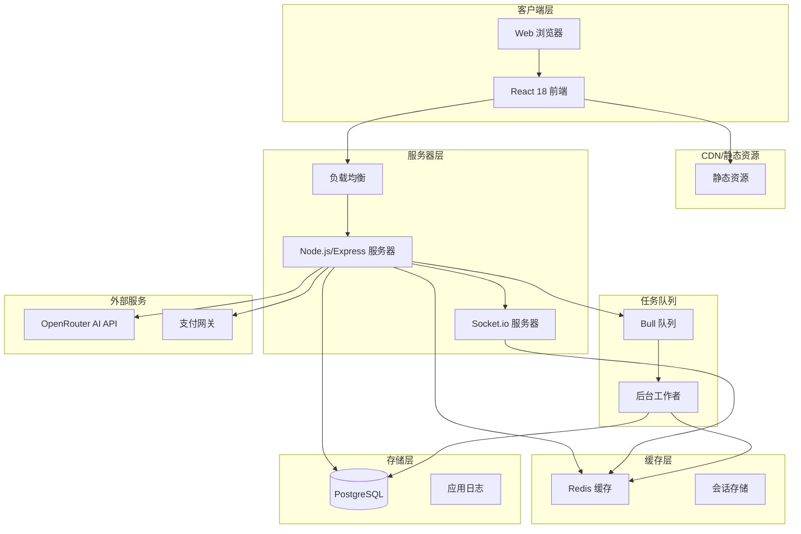
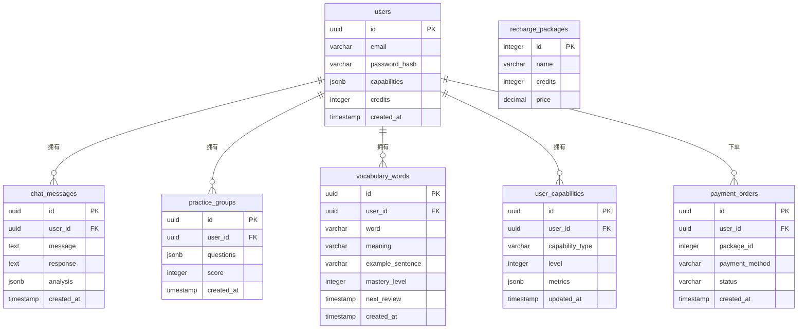
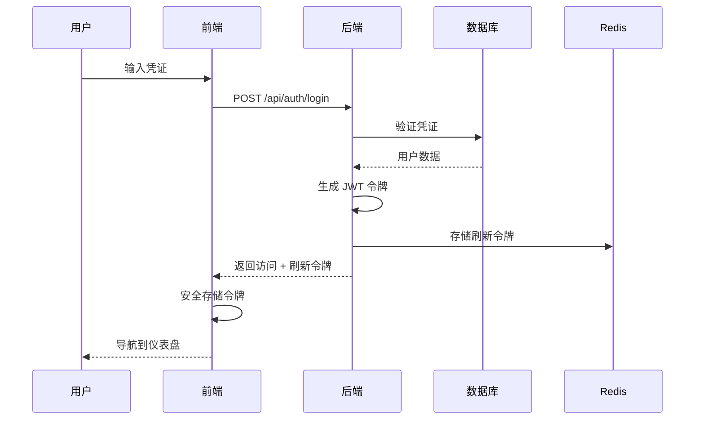
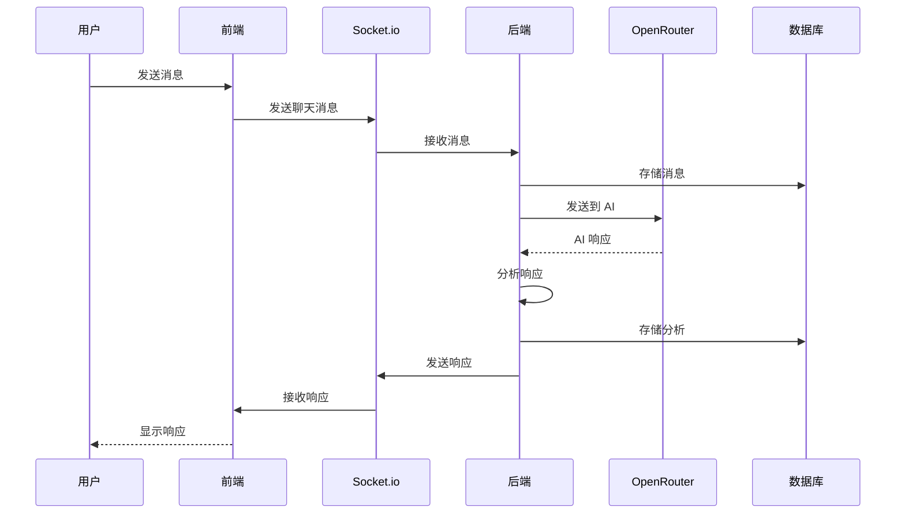
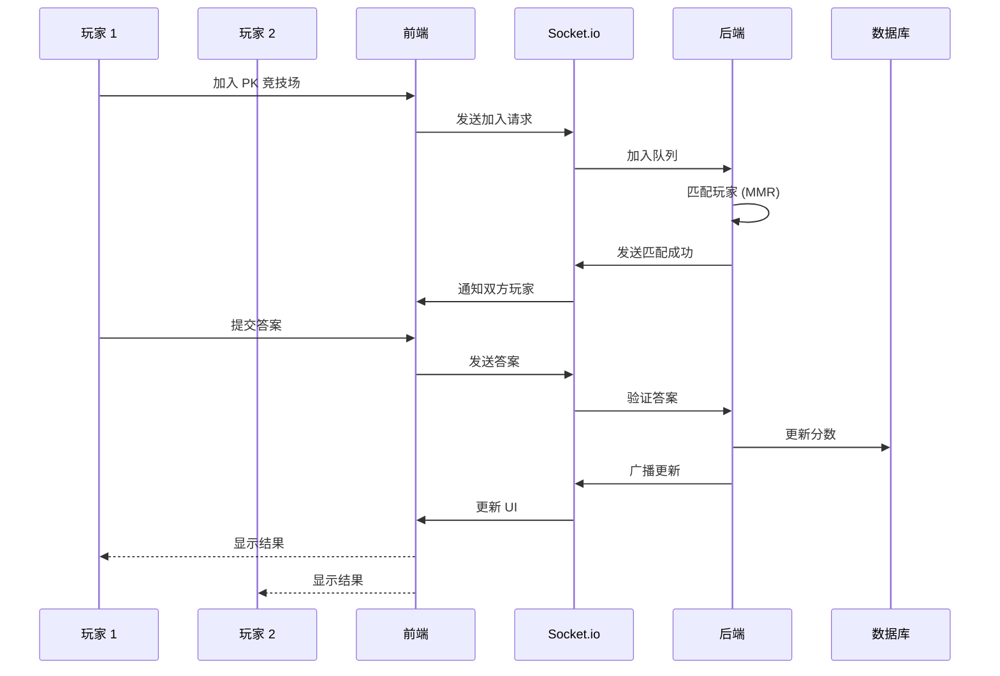
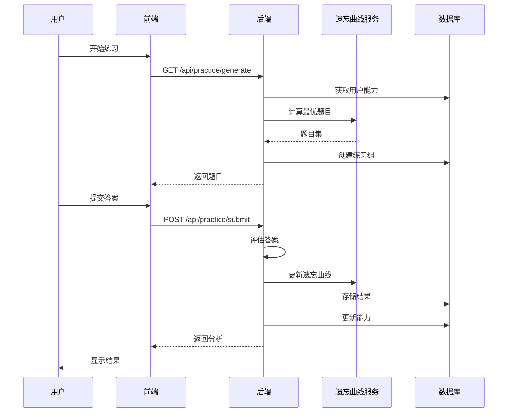

# Mnemos 项目架构文档

## 概述

Mnemos 是一个全栈 AI 驱动的语言学习应用，具有实时互动功能。

## 系统架构



## 后端架构

```mermaid
graph TB
    subgraph Entry["入口"]
        Server[server.ts]
    end

    subgraph Middleware["中间件层"]
        ErrorHandler[errorHandler]
        Security[security/auth]
        Performance[performance]
        Validate[validate]
        NotFound[notFoundHandler]
    end

    subgraph Routes["API 路由"]
        Auth[authRoutes]
        User[userRoutes]
        Chat[chatRoutes]
        Practice[practiceRoutes]
        Vocab[vocabularyRoutes]
        PK[pkRoutes]
        Payment[paymentRoutes]
        Admin[adminRoutes]
        Tasks[taskRoutes]
        Assessment[assessmentRoutes]
        DailyRec[dailyRecommendationRoutes]
        Monitoring[monitoringRoutes]
        UserLang[userLanguageRoutes]
    end

    subgraph Controllers["控制器"]
        AuthCtrl[AuthController]
        UserCtrl[UserController]
        ChatCtrl[ChatController]
        PracticeCtrl[PracticeController]
        VocabCtrl[VocabularyController]
        PKCtrl[PKController]
        PaymentCtrl[PaymentController]
        AdminCtrl[AdminController]
        TaskCtrl[TaskController]
        AssessCtrl[AssessmentController]
        DailyRecCtrl[DailyRecommendationController]
        UserLangCtrl[UserLanguageController]
        SimpleUserCtrl[SimpleUserController]
    end

    subgraph Services["业务服务"]
        AISvc[AIService]
        AIFunc[AIFunctionService]
        AIPrompt[AIPromptService]
        AIAssess[AIAssessmentService]
        ChatService[ChatService]
        UserService[UserService]
        PracticeGen[PracticeGenerationService]
        PracticeQ[PracticeQuestionService]
        PracticeAna[PracticeAnalysisService]
        PracticeEval[PracticeEvaluationService]
        VocabPractice[VocabularyPracticeService]
        VocabService[VocabularyService]
        PKBattle[PKBattleService]
        PKMatch[PKMatchingService]
        PKReward[PKRewardService]
        PKScheduler[PKSchedulerService]
        MMR[MMRService]
        PaymentSvc[PaymentService]
        PaymentGW[PaymentGatewayService]
        Credit[CreditService]
        TaskQueue[TaskQueueManager]
        AsyncTask[AsyncTaskManager]
        TaskResult[TaskResultManager]
        DailyRecSvc[DailyRecommendationService]
        Capability[UserCapabilityService]
        CapabilityUpdate[CapabilityUpdateService]
        Reassessment[ReassessmentService]
        UserLangSvc[UserLanguageService]
        MonitorSvc[MonitoringService]
        DBOptim[DatabaseOptimizationService]
        CacheSvc[CacheService]
        Forgetting[ForgettingCurveService]
        OpenRouter[OpenRouterService]
    end

    subgraph Models["数据模型"]
        User[User]
        ChatMsg[ChatMessage]
        PracticeGp[PracticeGroup]
        VocabWord[VocabularyWord]
        UserCap[UserCapability]
        PaymentOrd[PaymentOrder]
        RechargePkg[RechargePackage]
    end

    subgraph Config["配置"]
        DB[database.ts]
        Redis[redis.ts]
        Migration[migration.ts]
        Models[modelConfig.ts]
    end

    Server --> Middleware
    Middleware --> Routes
    Routes --> Controllers
    Controllers --> Services
    Services --> Models
    Services --> Config
```



## 前端架构

```mermaid
graph TB
    subgraph Root["应用根组件"]
        App[App.tsx]
        Index[index.tsx]
    end

    subgraph Theme["主题系统"]
        Theme[theme.ts]
        Light[浅色模式]
        Dark[深色模式]
    end

    subgraph Store["Redux Store"]
        Store[store.ts]
        Hooks[hooks.ts]
    end

    subgraph Slices["Redux Slices"]
        Auth[authSlice]
        Chat[chatSlice]
        Practice[practiceSlice]
        Vocab[vocabularySlice]
        PK[pkSlice]
        Payment[paymentSlice]
        DailyRec[dailyRecommendationSlice]
    end

    subgraph Pages["页面组件"]
        Dashboard[DashboardPage]
        AuthP[AuthPage]
        ChatP[ChatPage]
        PracticeP[PracticePage]
        VocabP[VocabularyPage]
        PKP[PKArenaPage]
        ProfileP[ProfilePage]
        AdminP[AdminPage]
        AssessmentP[AssessmentPage]
        RechargeP[RechargePage]
        PracticeHist[PracticeHistoryPage]
    end

    subgraph Components["组件层"]
        Layout[布局组件]
        Common[通用 UI 组件]
        Feature[功能组件]
    end

    subgraph Services["API 服务"]
        Api[api.ts]
        ChatApi[chatApi]
        PracticeApi[practiceApi]
        VocabApi[vocabularyApi]
        PaymentApi[paymentApi]
        AdminApi[adminApi]
        AssessmentApi[assessmentApi]
        UserLangApi[userLanguageApi]
        DailyRecApi[dailyRecommendationApi]
    end

    subgraph Utils["工具函数"]
        Security[security.ts]
        Validation[validation.ts]
        ErrorH[errorHandler.ts]
        Perf[performance.ts]
        Constants[constants.ts]
    end

    subgraph Types["类型定义"]
        Types[types/index.ts]
    end

    Index --> App
    App --> Theme
    App --> Store
    Store --> Slices
    App --> Pages
    Pages --> Components
    Pages --> Services
    Services --> Utils
    Services --> Types
```

## 组件架构

```mermaid
graph TB
    subgraph Layout["布局组件"]
        Layout[Layout.tsx]
    end

    subgraph Auth["认证"]
        Protected[ProtectedRoute]
        Password[PasswordStrengthIndicator]
    end

    subgraph Common["通用 UI"]
        Loading[LoadingSpinner]
        LoadBtn[LoadingButton]
        ErrorB[ErrorBoundary]
        Markdown[MarkdownRenderer]
        Notif[NotificationProvider]
        PageTrans[PageTransition]
    end

    subgraph Chat["聊天组件"]
        ChatInterface[ChatInterface]
        MsgBubble[MessageBubble]
        TaskProg[TaskProgressIndicator]
    end

    subgraph Practice["练习组件"]
        Question[QuestionCard]
        Group[PracticeGroup]
        Result[PracticeResultDetail]
        Summary[ResultSummary]
        FollowUp[FollowUpDialog]
        InlineFollow[InlineFollowUp]
    end

    subgraph Vocabulary["词汇组件"]
        WordCard[VocabularyWordCard]
        Mastery[MasteryStatsCard]
        VocabPractice[VocabularyPractice]
    end

    subgraph PK["PK 对战组件"]
        Battle[PKBattleInterface]
        Match[PKMatchingInterface]
        History[PKBattleHistory]
        Leaderboard[PKLeaderboard]
    end

    subgraph Payment["支付组件"]
        PkgCard[PackageCard]
        Method[PaymentMethodSelector]
        Balance[CreditBalance]
        TransHist[TransactionHistory]
    end

    subgraph DailyRec["每日推荐"]
        RecCard[DailyRecommendationCard]
        RecItem[RecommendationItem]
        QuickPractice[QuickPracticeOptions]
        Feedback[FeedbackModal]
    end

    subgraph Admin["管理组件"]
        SysStats[SystemStats]
        UserMgr[UserManager]
        PkgMgr[PackageManager]
        TaskMgr[TaskQueueManager]
        Monitor[OpenRouterConfig]
        SysMon[SystemMonitoring]
    end

    subgraph Profile["用户资料"]
        PracticeHist[PracticeHistorySummary]
    end
```

## 数据库 Schema



## 数据流

### 认证流程



### AI 聊天流程



### PK 对战流程



### 练习流程（含遗忘曲线）



## 目录结构

```
Mnemos/
├── backend/
│   ├── database/
│   │   └── migrations/          # SQL 迁移文件
│   ├── scripts/                 # 工具脚本
│   └── src/
│       ├── config/              # 配置文件
│       ├── controllers/         # 请求处理器
│       ├── middleware/          # Express 中间件
│       ├── models/              # 数据模型
│       ├── routes/              # API 路由定义
│       ├── services/            # 业务逻辑
│       ├── test/                # 测试文件
│       ├── types/               # TypeScript 类型
│       └── utils/               # 工具函数
│
├── frontend/
│   └── src/
│       ├── components/          # React 组件
│       │   ├── Admin/           # 管理组件
│       │   ├── Auth/            # 认证组件
│       │   ├── Chat/            # 聊天组件
│       │   ├── DailyRecommendation/ # 每日推荐组件
│       │   ├── Layout/          # 布局组件
│       │   ├── Payment/         # 支付组件
│       │   ├── PK/              # PK 对战组件
│       │   ├── Practice/        # 练习组件
│       │   ├── Profile/         # 用户资料组件
│       │   ├── Vocabulary/      # 词汇组件
│       │   └── common/          # 通用组件
│       ├── pages/               # 页面组件
│       ├── services/            # API 服务
│       ├── store/               # Redux store
│       │   ├── slices/          # Redux slices
│       │   └── store.ts         # Store 配置
│       ├── theme/               # Material-UI 主题
│       ├── types/               # TypeScript 类型
│       └── utils/               # 工具函数
│
├── database/                    # 数据库文件
├── doc/                         # 文档
│   └── architecture.md          # 架构文档
├── scripts/                     # 根目录脚本
└── .github/                     # GitHub 配置
```

## 技术栈

| 层级 | 技术 |
|------|------|
| **前端** | React 18, Redux Toolkit, Material-UI, TypeScript |
| **后端** | Node.js, Express, TypeScript |
| **数据库** | PostgreSQL 15 |
| **缓存** | Redis 7 |
| **实时通信** | Socket.io |
| **任务队列** | Bull |
| **AI** | OpenRouter API |
| **容器化** | Docker, Docker Compose |

## API 端点概览

| 端点 | 描述 |
|------|------|
| `/api/auth` | 认证（注册、登录、刷新） |
| `/api/users` | 用户管理 |
| `/api/chat` | AI 聊天及分析 |
| `/api/practice` | 练习题目 |
| `/api/vocabulary` | 词汇管理 |
| `/api/pk` | PK 对战 |
| `/api/payment` | 支付处理 |
| `/api/admin` | 管理功能 |
| `/api/tasks` | 后台任务 |
| `/api/daily-recommendations` | 个性化推荐 |
| `/api/monitoring` | 系统监控 |
| `/api/user-languages` | 语言能力 |
| `/api/assessment` | 测试评估 |
