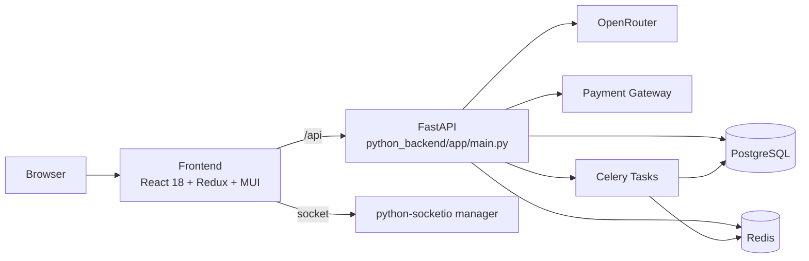
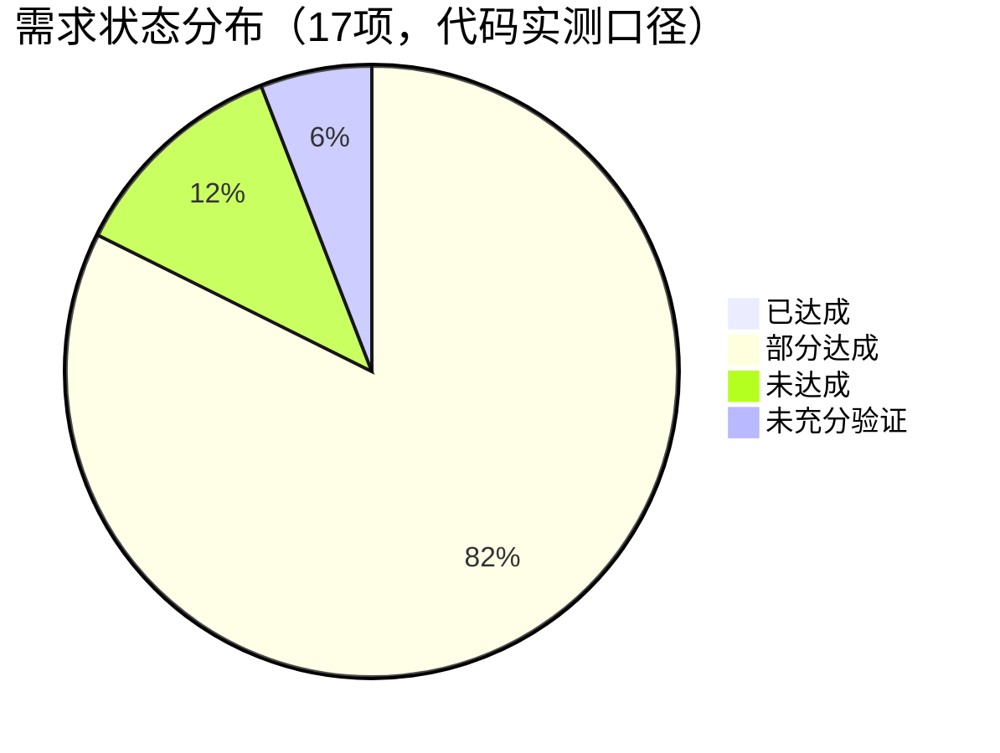
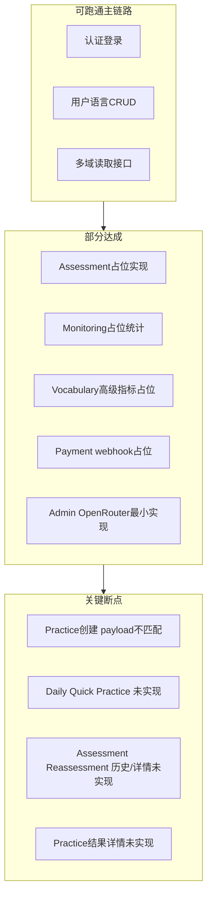

# Mnemos 项目架构与完成度梳理（代码实测版，2026-02-23）

## 1. 结论先行

本版结论基于**代码阅读 + 运行时验证**，不是只按 `.kiro` 文档勾选。

- 架构主链路可运行：`Frontend(React)` → `FastAPI` → `PostgreSQL/Redis`。
- 大部分“读操作”与基础业务接口可用（多域 200）。
- 仍存在“接口存在但实现占位”与“前端交互 payload 不匹配”问题。
- 因此当前状态应定义为：**核心框架可用，需求达成度为“部分完成”，不能认定全面完成**。

---

## 2. 验证方法（本次实际执行）

1) 代码结构核对
- 核对 `python_backend/app/api/routes/*.py`、`app/services/*.py`、`app/tasks/*.py`
- 核对 `frontend/src/services/*.ts` 与 `frontend/src/pages/*.tsx` 的真实调用链

2) 页面运行验证
- 使用现有 Playwright 脚本：`scripts/tmp_route_scan.js`、`scripts/tmp_regression_auth.js`
- 额外执行：真实点击“练习页创建练习”流程

3) 接口运行验证
- 登录获取 token 后，跨域调用 auth/users/chat/practice/vocabulary/payment/daily/assessment/pk/tasks/admin 关键接口
- 对可疑接口读取实际响应体，判定是否真实实现或占位实现

---

## 3. 当前实际架构（代码层）

代码证据：
- 路由注册在 `python_backend/app/main.py`
- 路由模块在 `python_backend/app/api/routes/`
- 前端 service 在 `frontend/src/services/`
- 开发命令由根 `Makefile` 指向 Python 后端（`make dev`）

---

## 4. 交互链路实测结果（以“可跑通”为准）

## 4.1 通过（可跑通）
- 认证主链路：登录成功、token 落地、受保护页面可访问（auth 回归脚本通过）。
- 用户语言管理：`GET/POST/PUT/DELETE /api/user-languages` 全链路 200。
- 多域读接口：
  - `/api/auth/profile`
  - `/api/users/learning-status`
  - `/api/chat/history`
  - `/api/practice/groups`
  - `/api/vocabulary/words`
  - `/api/payment/credits`
  - `/api/daily-recommendations/en/today`
  - `/api/assessment/capabilities`
  - `/api/pk/stats`
  - `/api/tasks/user`
  - `/api/admin/statistics`
  - `/api/admin/queue-metrics`
  - `/api/admin/openrouter/models`

## 4.2 部分通过（接口可用但不满足需求深度）
- Assessment：
  - `POST /api/assessment/comprehensive` 返回固定示例数据（非真实评估）
  - `GET /api/assessment/history/{language}` 返回空数组占位
  - `POST /api/assessment/reassessment` 返回 pending + 空 questions 占位
- Monitoring：
  - `/database/stats` 的 `activeUsers/totalPractices/totalChatMessages` 为 0 占位
  - `/cache/stats` 返回固定 0 值
- Vocabulary：
  - `scheduled-reviews/review-reminders/forgetting-curve-metrics/learning-efficiency-metrics` 为占位返回
- Admin OpenRouter：
  - 配置/测试/用量/模型接口可访问，但明显为“最小可用/模拟数据”实现
- Payment webhook：
  - `POST /api/payment/webhook` 当前仅 `Webhook received`，无签名校验与状态更新闭环

## 4.3 未通过（真实交互链路断点）
- **练习创建 UI 断点（已实测）**
  - 页面操作：Practice 页点击“创建练习”→“🤖 智能生成”
  - 实际请求：`POST /api/practice/generate-group`
  - 结果：400，缺少 `skillAreas`
  - 根因：前端请求体与后端 `PracticeGroupCreate` 模型不一致（前端发 `type`，后端强制 `skillAreas`）

- **Daily Quick Practice 未实现（代码级断点）**
  - `frontend/src/services/dailyRecommendationApi.ts` 中 `generateQuickPractice` 直接 `throw`

- **Assessment reassessment 历史/详情链路未实现（代码级断点）**
  - `frontend/src/services/assessmentApi.ts` 中 `getReassessmentHistory/getReassessmentCase/...` 直接 `throw`

- **Practice 结果详情链路未实现（代码级断点）**
  - `frontend/src/services/practiceApi.ts` 中 `getPracticeResultDetail` 直接 `throw`

---

## 5. 需求完成度（基于代码与运行，不按文档勾选）

> 评级说明：
> - 已达成：核心交互可跑通且无明显占位
> - 部分达成：可访问但存在占位实现/关键分支缺失
> - 未达成：关键交互链路断开

- 需求 1（注册登录与语言设置）：**部分达成**（认证可用，语言设置可用；首次引导细节未完整验收）
- 需求 2（AI 聊天+操作）：**部分达成**（聊天接口可调；当前环境 OpenRouter 401 导致 AI 响应失败）
- 需求 3（付费服务）：**部分达成**（支付接口在；本环境套餐数据为空，完整支付链未跑通）
- 需求 4（管理员）：**部分达成**（管理接口大多可访问，但多处为最小实现/占位数据）
- 需求 5（UI/交互质量）：**部分达成**（页面可访问，但 route scan 有若干控制台警告）
- 需求 6（每日建议）：**部分达成**（today/generate/history可用，quick-practice 未实现）
- 需求 7（能力评估）：**部分达成**（基础能力接口在，综合评估与再评估链路为占位）
- 需求 8（学习目标与里程碑）：**未充分验证**（本轮未发现完整里程碑闭环代码证据）
- 需求 9（定制练习）：**未达成（关键链路断点）**（Practice 创建实测 400）
- 需求 10（遗忘曲线复习）：**部分达成**（框架在，关键指标和提醒为占位）
- 需求 11（练习组管理）：**部分达成**（组查询/提交接口在，但创建链路当前断）
- 需求 12（Credit 计费）：**部分达成**（credit 相关接口在，端到端计费规则未完整实测）
- 需求 13（PK 对战）：**部分达成**（匹配/统计接口可用；公平性与完整对战流程未全链路验收）
- 需求 14（生词表自动管理）：**部分达成**（CRUD 可用，复习提醒/效率分析等为占位）
- 需求 15（充值购买）：**部分达成**（接口在；本环境无套餐，无法完成购买闭环）
- 需求 16（套餐管理）：**部分达成**（admin package CRUD 在）
- 需求 17（AI 全能助手完成所有操作）：**未达成**（多个关键操作仍无后端端点或前端直接 fail-fast）

---

## 6. 可视化：完成态分布

---

## 7. 与“.kiro 设计链路”的差异（代码视角）

- `.kiro` 里“任务已勾选”不等价于“交互验收通过”。
- 目前存在较多“接口存在但返回占位值”的情况，这在需求验收口径下只能算“部分完成”。
- 需要从“端点存在性”升级到“场景可跑通 + 数据语义正确 + 前端真实可用”的验收方式。

---

## 8. 建议下一步（按阻塞优先级）

1. 修复 Practice 创建入参契约（前端 `practiceApi` 与后端 `PracticeGroupCreate` 对齐）。
2. 补齐 Quick Practice 后端端点与前端 thunk 调用。
3. 补齐 reassessment 历史/详情/提交/取消端点与前端调用。
4. 将 assessment/monitoring/vocabulary/payment webhook 的占位实现替换为真实逻辑。
5. 增加“交互级自动验收”（Playwright 场景 + 接口断言），作为完成判定标准。
